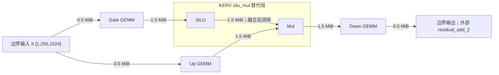

# Search Subgraph Cost Coverage Audit

正式阶段顺序、三种成本语义与测量入口见 `cost_model/STAGE_B_PROTOCOL.md`。

阶段 A；Qwen3-0.6B Builder 的第 0 层 FFN；2026-11-02。未采集新 GPU 数据，未运行 Exact/MCTS，未修改准入状态。

## Evidence Coverage 与 Search Cost Coverage

| 指标 | 当前值 | 范围 |
|---|---:|---|
| Evidence Coverage | **2/2 配对比较 Case** | 两卡选定 KERV 与 Native 对照；P2 限定用途 |
| Search Cost Coverage | **0 个独立搜索成本项** | singleton/link/whole-plan 搜索用途未开放 |

需求集合尚未由边界驻留、实际放置与配对矩阵固定，分母未定，不使用“2/18”或“补测16项”。选定 KERV 的正式 Profile 可在局部比较 proxy 中严格查询，不等于独立搜索成本准入。

| 审计对象 | 结构上的候选用途 | 当前限制 |
|---|---:|---|
| FFN singleton × 两卡 | 5 × 2 个节点用途 | GPU Reference 身份与布局尚未实地绑定；B0 本机 CPU 验证另记 |
| Native 激活组合 | 两卡各一个对照臂 | comparison_only，未开放搜索用途 |
| 完整 FFN Native/Fused | 两卡各一个配对 Case 的候选范围 | 具体矩阵待 B3；不可按 Profile 行数直接开测 |
| 通信 | 两尺寸 × 双方向，4 种潜在查询类别 | 实际传输集合待 B1合法动作空间/B2，不是4项必测任务 |

机器清单：`data/search_subgraph_cost_audit_v1/report.json` 的 `evidence_coverage` 与 `search_cost_coverage` 分开记录；`potential_link_query_classes` 仅列可能类别，`actual_transfer_measurement_cases=null`。每条图边保留 source_device、destination_device、tensor_shape、tensor_bytes、transfer_required、synchronization；B1/B2 未完成时设备与传输必要性保持未定。

P2 明确设置 `singleton_costs_admitted=false`、`link_costs_admitted=false`、`hardware_profile_sharing=false`、`whole_plan_costs_admitted=false`。严格 overlay 遇到普通计算 singleton 或正字节通信会拒绝，不会退回解析估计。（`cost_model/kerv_admission.py:16`、`cost_model/kerv_profile.py:229`、`cost_model/kerv_profile.py:238`）

## 子图与边界

来源是仓库的模型形状 Builder，不是 FlagScale 运行时捕获的真实计算图；输入测量使用合成边界 Tensor。完整 Builder 图 **591 节点**，28 层 FFN 仅 **1 种 Shape 模板**；本次重建图哈希与两份 P2 PlacedOpGraph 一致。hidden=1024，FFN width=3072，batch=1，seq=256，BF16，无 Linear bias。（`cost_model/search_evaluation.py:49`、`simulator/model_graphs/dense_layer.py:302`）



| 节点（均带 L000. 前缀） | 语义及输出 | 实现状态 / Key 检查 |
|---|---|---|
| pre_mlp_norm | 已完成 Norm 的边界值 [1,256,1024] | 子图不计 Norm 算时或其参数；输入驻留位置必须另行固定 |
| mlp.gate_proj | GEMM (m,n,k)=(256,3072,1024)，输出 [1,256,3072] | reference 用 torch.matmul；无本次执行来源绑定；draft Key 有 implementation/layout 缺项 |
| mlp.up_proj | 同 GEMM Shape、同输出 | 独立图节点；semantic_slice=up，与 gate 的 Key 不同，不能默认共享 |
| mlp.silu | SiLU，[1,256,3072] | reference 用 F.silu；独立 Native Kernel 尚无 accepted Key |
| mlp.gated_mul | SiLU(gate) × up，同 Shape | reference 用 Tensor 乘法；独立 Native Kernel 尚无 accepted Key |
| mlp.down_proj | GEMM (256,1024,3072)，输出 [1,256,1024] | reference 用 torch.matmul；无本次执行来源绑定；draft Key 有缺项 |

三个 GEMM 参数各 **6,291,456 bytes**，总 **18 MiB**；权重按驻留参数处理，不凭空加入每次调用的搬运。扩展到权重分片或迁移时另建边和实现契约。reference executor 目前只执行 singleton；已有 KERV Adapter 只绑定选定融合组，尚无包含这三个 GEMM 的统一 FFN 融合执行器。（`execution/reference.py:124`、`execution/reference.py:195`、`integration/flagscale/kerv_execution.py:181`）

`GroupKernelKeys` 的原始 Builder draft 未带执行环境与布局，仍不具备可信 Profile 身份。B0 已增加按 `unfused:matmul/silu/mul` 分派的实际实现绑定与独立布局来源检查；本机 CPU 的5个 Key无缺项，不能覆盖两卡 GPU draft。审计 JSON 保留 GPU 原始 draft 与 identity_gaps；B0 实现和本地结果见 `execution/REFERENCE_IDENTITY.md`、`data/reference_identity_b0_v1/identity.json`。（`cost_model/fusion_kernel_profile.py:59`）

### 边的覆盖

| 边 | bytes | 放置变化的影响 |
|---|---:|---|
| pre_mlp_norm → gate_proj | 524,288 | 输入与 Gate 不同卡时传输 |
| pre_mlp_norm → up_proj | 524,288 | 输入与 Up 不同卡时传输；相同源不能未经验证就合并复制 |
| gate_proj → silu | 1,572,864 | 融合后仍为 Gate → KERV 的外部输入边 |
| silu → gated_mul | 1,572,864 | KERV 内部表达式，不再产生跨组 Tensor 边 |
| up_proj → gated_mul | 1,572,864 | 融合后仍为 Up → KERV 的外部输入边 |
| gated_mul → down_proj | 1,572,864 | 输出与 Down 不同卡时传输 |
| down_proj → residual_add_2（子图外） | 524,288 | 只有固定外部消费者位置后才能确定是否需传输 |

内部 **6 条边**，出口另 **1 条**。潜在跨卡查询类别为 `(0→1, 524288)`、`(1→0, 524288)`、`(0→1, 1572864)`、`(1→0, 1572864)` 四类；实际测量清单尚未确定。先定义边界约束与完整合法动作空间，再对所有合法方案的跨卡边取并集；某个全同卡方案无传输，不代表整个空间无通信需求。激活核心子图的潜在通信大小仅为 1.5 MiB。

历史 `raw_measurements.json` 在两个方向各有 6 个尺寸点（4 KiB～256 MiB），可以被旧代价模型插值查询；这不等于通过同一 Measurement Contract 的准入。旧链路估计接口尚未经过 Kernel 使用的 MeasurementLabelLookup，当前 P2 overlay 则直接拒绝通信成本。（`cost_model/measured_profile.py:480`、`cost_model/kerv_profile.py:229`）

阶段 B 必须选择实际 copy/通信实现，固定双端 UUID、P2P 路径、Tensor layout、流、生产者完成到消费者可用的计时边界与同步方式；不能只计异步 API 返回。单次传输及其依赖要与单算子 Graph proxy 的组合口径验证。PP stage 边界由下游负责，本轮不把层间 Pipeline 通信纳入层内放置审计。

## 已准入的融合组

两卡均为 `gfx936:sramecc+:xnack-`，保持逐卡记录，不共享 Profile。以下为同卡配对、同契约的中位值（μs/call）；GPU0 与 GPU1 的完整 Contract ID 不相同，不能跨卡直接按同一个 ID 查询。

| 设备 | KERV accepted | Native comparison_only | KERV Canonical Key |
|---|---:|---:|---|
| GPU0 | 7.2511798143 | 10.3167796135 | sha256:2cfa617ace0ee3af1e7c9e12d8f99f6af409c3e64a575134e9be3679d74bca80 |
| GPU1 | 7.2320002317 | 11.2543594837 | sha256:d53d35cfc3cc280317d00b41ae897d5300c6f42be70fd7af959b891dee751d36 |

- GPU0 Contract：`sha256:f4cbdf92046f460ce1c8c76c3b35229d634717fab8a9323b604b274d608c9d70`。
- GPU1 Contract：`sha256:ce6b7d7f1a74fbbd95d58252764487ce5f7d707ef520585de5bfa0d7988af507`。
- 决策：`sha256:d515655fab5ce53f21bbea060298210d10c07a37b0b5a5e285a5ae4a47bdb795`；use=`selected_fused_group_graph_batch_proxy`。

每卡 7 轮 × 50 次，10 次预热；所有 50 个输出保留并逐轮检查，Event 包围 Graph replay，恢复 gate 在计时外。绑定与证据可从报告中的 record_id → source_record_id / admission decision → 原始 result、trace、placed 追溯。Native 两 Kernel 的组合总时间不能分摊成 SiLU 或 Mul 标签。（`data/kerv_profile_admission_v1/strict_cost_queries.json:1`、`cost_model/kerv_admission.py:26`）

KERV 原地覆盖 gate，Mul 输出与 gate 别名；此层 gate 在 SiLU 外没有额外消费者，SiLU 内部值也不被组外使用。搜索必须沿用 Adapter 的别名/旧值失效检查。两输入改为预置逻辑边界后可以严格查询局部融合成本；把输入 GEMM 算时或跨卡输入成本设为零并不适用于完整 FFN。

## 历史测量与组合误差

`data/fusion_cost_validation_v1/inputs/gpu{0,1}_seq256/result.json` 已有同 Shape 的四臂 Graph 诊断。以下数值均来自该旧实验，不能与上节 P2 的单项数值拼表评分。

| 设备 | SiLU 中位 | Mul 中位 | Native chain 中位 | Fused 中位 | ΣT_single − T_chain（逐轮中位） | (ΣT_single − T_chain)/T_chain（逐轮中位） |
|---|---:|---:|---:|---:|---:|---:|
| GPU0 | 7.289570 | 4.734360 | 11.033600 | 8.028760 | **+0.887990 μs** | +7.8884% |
| GPU1 | 7.555200 | 4.675200 | 10.731200 | 8.172800 | **+1.075200 μs** | +10.0466% |

统一采用 `Δ_add = ΣT_single − T_chain`，先逐轮计算再取中位；不是用各列中位相减。正值表示单项加和高于链路实测。反向量 `R_chain = T_chain − ΣT_single` 则为 GPU0/1 的 −0.887990/−1.075200 μs；两种量含义相同、符号相反。本表沿用原始采集器的正向定义，不修改历史原始数据。（`calibration/probe_kerv_additivity.py:59`）

旧协议 **8 轮 × 50 次**，只保留最后一个输出；P2 是 **7 轮 × 50 次**，保留全部重放输出。旧 Contract `sha256:b0b0cd8a76c3bbe3d4924d718cc4d84807043c2c7643fdc12a7324a501f49c48` 也没有本次逐卡绑定的完整身份。这些是已有诊断数据，尚不能直接升级成当前 accepted 单算子/链路标签。（`calibration/probe_kerv_additivity.py:32`）

历史原始 BW1000 Kernel 表还有 **36 条 legacy_unbound**；本轮没有将其升格。（`data/fixed_profile_audit_v1/report.json:29`）

另有本地归档 `E:/Chatgpt_work/transfer/scnet-group-key-20261031-185721/received/group_key_mlp_dcu310_20261031_185721/formal/verified_profile.json`：`accepted_keys=12` 表示该轮 `development_isolated_kernels` 采集器的覆盖完整性，记录无本次 P2 admission 字段，且含旧设备身份与不同计时口径。它不是本表的 12 条正式 accepted；这里只保留历史来源，不参与覆盖分子。（该归档 `:5`、`:8`；SHA256 `4dbf612f07895a649e4529996c1e566fe7ab27b1e595e6b056d389711d87da40`，归档不在仓库内）

完整 FFN 的预测也不是全图耗时直接相加：结构模型按设备队列、前驱就绪、通信与共享链路资源推进时间；Gate/Up 的分叉是否并发取决于具体设备与执行流。单流链残差不能直接当成双卡并行 DAG 的修正项。（`cost_model/structural.py:194`、`cost_model/structural.py:234`）

## 阶段 B 入口与顺序

| 阶段 | 工作 | GPU测量 | 当前状态 |
|---|---|---|---|
| B0 | Reference singleton Identity 与布局来源闭合 | 无 | 代码与本机CPU验收通过；BW1000身份在B4计时前捕获 |
| B1 | 合法融合动作空间、允许设备与可达放置 | 无 | GPU0边界场景完成，48带标签/24计算结构类 |
| B2 | 全部合法方案的跨卡边并集与唯一通信清单 | 无 | 待B1合法动作空间 |
| B3 | 定义同 Case/Contract/Recipe 的 Fused/Native 配对矩阵 | 无 | 待开展 |
| B4 | BW1000身份捕获、配对测量与准入 | 有 | B0～B3通过后先核身份，再计时 |
| B5 | 通信成本与链路组合验证 | 有 | 待B4；Δ_add = ΣT_single − T_chain |
| B5.5 | 同算法解析/正式成本Before–After决策对照 | 无 | 待B5 |
| B6 | FFN Exact/Guided/Sequential/Joint对照 | 视设计 | 待B5.5；完整图另列C阶段 |

B0 不把未知布局写为 contiguous。图声明必须有来源标识；运行时观测读取真实 Tensor 的 shape/dtype/stride/is_contiguous。未知值保留并被严格身份检查拒绝；GEMM 常驻 weight 也需要独立布局来源。身份完整只表示能够进入后续测量与准入检查，不产生 accepted 时延标签。

B3 按配对 Case 管理，Fused 是实际 KERV 路径，Native 是对应 Reference 算子分解；同 Case、同 Contract、同 Recipe，执行路径分别记录。禁止 GPU实测与解析估计、Graph与Eager、GPU0与GPU1数据直接混比。单算子标签与原生组合成本分别定义，不能把组合总时间拆成 singleton 标签。

历史四臂实验先核对身份与契约适用范围；若不满足新 Case，重新定义配对测量，不能拼接旧标签或预设10～14行就是固定测量集。通信需求取全部合法方案的跨卡边并集，不能从一个参考方案推导。B2按方向、大小及执行/同步语义归并，四种潜在类别是否都需要由B1确认。

28 层当前 FFN 形状相同，不能先验认定逐层融合收益有差异；两卡局部融合收益不同也尚不能证明最优放置改变。Exact/MCTS 均保持未启动；14/14、16/12 的 PP 层切分归下游。

## 重放

在仓库根目录执行：

```powershell
& 'C:/Users/LJ/miniconda3/envs/fusion-dev/python.exe' -m tools.audit_search_subgraph_cost
```

脚本只重建图、核对已保存证据及严格查询、导出清单。它会检查图快照一致、28 个可执行 KERV 位置、目标组一致、两次 accepted 精确查询、两次 Native 严格拒绝，以及两类分开的覆盖指标；GPU原始 Builder draft 的10个 singleton 用途仍保持缺项；不调用 GPU，不变更原始测量与准入决策。JSON 中保存输入文件 SHA256。Pinned FlagScale 源码需位于既有相邻目录，CPU 重放不加载 Triton 执行模块。
